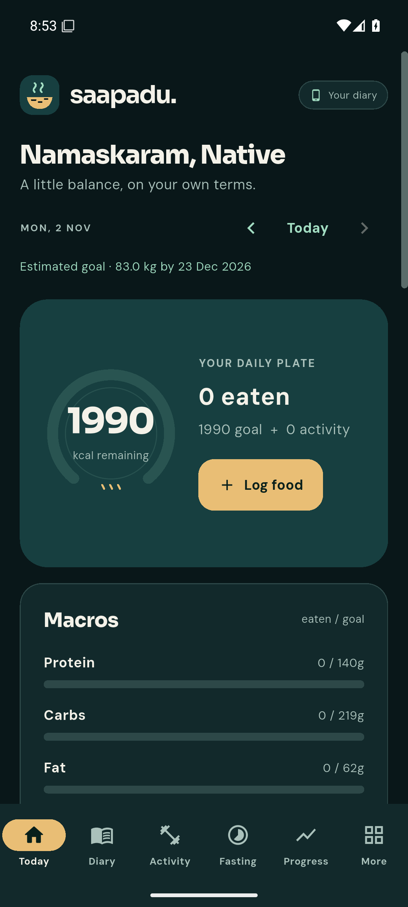

<div align="center">

# Saapadu

### South Indian food. A clearer daily rhythm.

Track meals, macros, movement, sleep, fasting, and weight over the weeks that actually matter.

Version **2.0.0** adds a native Android app with an original midnight-and-saffron
interface, a fully editable profile, dated weekly weigh-ins, and goal estimates
that respond to your recent weight trend. Meals, movement, fasting and history
stay together in one diary.

[](https://saapadu-tracker.vercel.app)
[](https://flutter.dev)
[](#)

</div>

Saapadu is a personal tracker built around familiar Indian portions. It connects the numbers behind a daily routine: current measurements inform calorie recommendations, weekly weigh-ins refine the estimated goal date, and logged movement can add a conservative activity credit.

## What it does

- **South Indian food diary** — 141 built-in foods, searchable aliases, practical serving sizes, and custom foods.
- **Complete nutrition view** — calories, protein, carbohydrates, fat, and fiber for every logged meal.
- **Editable profile** — update name, current weight, height, age, activity and the body reference used for calorie estimates.
- **Dynamic goal planning** — recommended or custom targets, weekly pace, a requested goal date, and a separate estimated completion date.
- **Weekly weight feedback** — dated, editable check-ins update the current plan while preserving historical diary targets. A recent trend informs the estimate once there are at least three readings spanning two weeks; the original requested date remains yours.
- **Activity tracking** — walking, running, cycling, strength training, yoga, cricket, badminton, swimming, HIIT, and more with MET-based estimates.
- **Daily wellness** — water, sleep, steps, manual watch calories, notes, and intermittent fasting.
- **Useful suggestions** — protein and fiber gap prompts plus practical next-meal ideas based on what is still missing.
- **Reliable storage** — automatic local persistence, JSON backup/restore, optional Google/Supabase sync, and a native Android session stored securely between launches.

## Try it

Open the hosted version at **[saapadu-tracker.vercel.app](https://saapadu-tracker.vercel.app)**. The web build works on phones and desktops and can be installed from a compatible browser as a progressive web app.

The **[Android 2.0 APK](https://github.com/tpavan03/saapadu-tracker/releases/download/v2.0.0/Saapadu-2.0.0.apk)** is the signed native Flutter app for Android 7 and newer. It renders on the device and has its own navigation and local storage. The first explicit Google sign-in can open a browser to authenticate; normal launches restore the saved session. You can also choose **Continue on this device** without an account.

See the **[Android installation, migration and build guide](docs/native_android.md)**. Keep the old app until you have restored its cloud history or copied its JSON backup; the new package can be installed alongside it.



## Run locally

```bash
flutter pub get
flutter test
flutter analyze
flutter run -d chrome
```

Build the website with:

```bash
flutter build web --release
```

Native release signing and the public Supabase build configuration are documented in [the Android guide](docs/native_android.md#build-from-source).

## Optional cloud history

The hosted website and personal Android build use the existing Supabase backend; version 2.0 needs **no database migration**. Google is the supported cloud sign-in option in this release. In-app email-code sign-in is disabled because the project has no custom SMTP provider.

For an independent deployment, create a Supabase project, apply the backup migrations, enable Google OAuth, and supply the public project values:

```bash
flutter build web --release \
  --dart-define=SUPABASE_URL=https://PROJECT_REF.supabase.co \
  --dart-define=SUPABASE_PUBLISHABLE_KEY=YOUR_PUBLISHABLE_KEY
```

See [`docs/cloud_setup.md`](docs/cloud_setup.md), the [current native callback and session behavior](docs/native_android.md#sign-in-and-local-storage), and [`supabase/migrations/202609170001_cloud_backup.sql`](supabase/migrations/202609170001_cloud_backup.sql). Never place a Supabase secret or `service_role` key in a client build.

**Historical backend verification, 28 October 2026:** auth health/settings returned **200**. Two disposable authenticated users passed their own backup **insert, upsert and reload**; cross-account reads/updates returned no rows, cross-account inserts were denied, and anonymous reads/writes were blocked. Synthetic records and accounts were removed. This records backend checks, not a native Google sign-in test; see [`docs/backend-verification.md`](docs/backend-verification.md) for the evidence and its limits.

## How the numbers are handled

The target uses a Mifflin–St Jeor estimate, an activity factor, goal direction, and conservative safety floors. Workout estimates use MET values and credit 50% of the largest overlapping movement estimate so steps, workouts, and watch totals are not blindly added together.

Weight forecasts use a recent observed trend when enough dated readings exist, otherwise a calorie-plan estimate. A plateau or movement away from the goal can leave the date unavailable. The app does not automatically cut calories to force a deadline, and these estimates are not medical advice.

The formulas, guardrails, nutrition sources, and workout assumptions are documented here:

- [`docs/health_calculations.md`](docs/health_calculations.md)
- [`docs/nutrition_sources.md`](docs/nutrition_sources.md)
- [`docs/workout_calculations.md`](docs/workout_calculations.md)

## Project shape

```text
lib/                 Flutter UI, state, models, and calculation engines
assets/data/         South Indian food catalog
supabase/migrations/ Optional cloud backup schema and row-level policies
docs/                Calculation notes, sources, and setup guides
test/                Calculation, profile, persistence, auth and layout checks
integration_test/    Isolated native-device smoke test
android/             Native Android host and release-signing configuration
web/                 PWA metadata, offline service worker, and Vercel headers
```

## Automatic web deployment

The existing Vercel project is connected to `tpavan03/saapadu-tracker`, with `main` as its production branch. A push to `main` runs the pinned Flutter web build in `scripts/vercel-build.sh` and publishes `build/web` to the existing production domain. The project's existing Supabase client configuration is supplied through Vercel environment variables; no replacement backend or database migration occurs on a frontend push. Android APK builds remain separate from web deployments.

Saapadu has no ads or analytics. Keep an occasional backup from **More → Data & backup** before clearing browser data or moving devices.

## Scheduled maintenance

A 90-day, source-checked documentation campaign runs through GitHub Actions. See the [campaign controls and schedule](docs/maintenance-campaign.md) and [handbook queue](docs/handbook/README.md).
